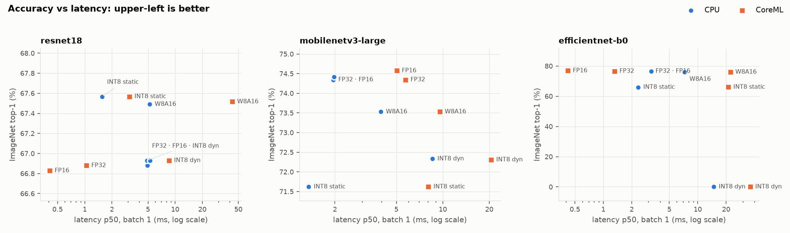
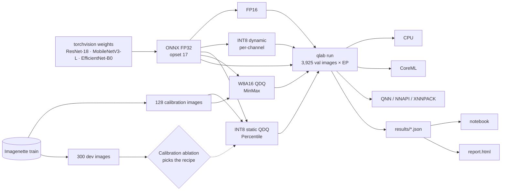
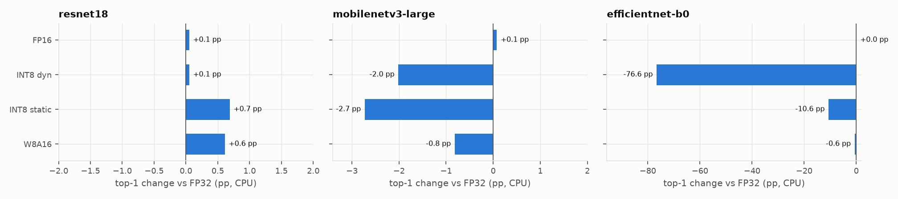
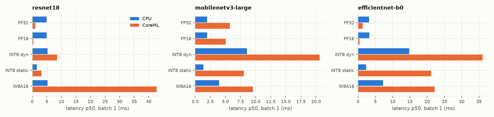

# quant-lab

[](https://github.com/RobiiAragon/quant-lab/actions/workflows/ci.yml)


[English](README.md) · **Español**

**¿Qué cuesta y qué te da realmente la cuantización, y en qué hardware?** quant-lab toma tres
modelos de visión de ImageNet y genera **cinco precisiones** de cada uno (FP32, FP16, INT8
dinámico, INT8 estático QDQ y W8A16 QDQ). Mide exactitud, acuerdo con FP32, latencia, tamaño y
cobertura del acelerador en CPU, Apple CoreML y Qualcomm QNN o NNAPI cuando existen. Los
resultados se publican como un notebook ejecutado y un reporte HTML autocontenido.



- **Modelos:** ResNet-18, MobileNetV3-Large y EfficientNet-B0 (pesos de torchvision, BSD-3),
  exportados a ONNX opset 17.
- **Variantes:** FP32 · FP16 · INT8 dinámico (por canal) · INT8 estático (QDQ, activaciones
  uint8 con calibración Percentile y pesos int8 por canal) · **W8A16** (QDQ, activaciones uint16:
  la receta del HTP de Qualcomm).
- **Evaluación:** las 3,925 imágenes de validación de Imagenette, top-1 **estricto de 1000
  clases de ImageNet**, exactitud entre las 10 clases y acuerdo con FP32. También latencia
  batch 1 p50/p90/p99 y cobertura del EP (nodos/particiones en el acelerador).
- **Receta elegida con datos de desarrollo:** una ablación de calibración sobre imágenes de
  *entrenamiento*, nunca sobre el set de evaluación.
- **Salidas:** [`notebooks/quant_lab.ipynb`](notebooks/quant_lab.ipynb) (ejecutado, con
  frontera de Pareto), [`docs/report.html`](https://robiiaragon.github.io/quant-lab/report.html)
  y figuras PNG.

> **¿Por qué no YOLO/Ultralytics?** Ultralytics es AGPL-3.0 y no encaja en un repo MIT. Los
> modelos de torchvision son BSD-3 y enseñan lo mismo: las convoluciones depthwise, los bloques
> SE y SiLU/hard-swish son justo donde la cuantización duele.

## Pipeline



## Inicio rápido

```bash
git clone https://github.com/RobiiAragon/quant-lab && cd quant-lab
python3.12 -m venv .venv && source .venv/bin/activate
pip install -e ".[dev]"

qlab download-models                        # 15 archivos ONNX del release (~250 MB)
qlab run --limit 500 --out results/mio.json   # descarga Imagenette (99 MB) una vez
qlab report results/mio.json --out-dir out    # figuras + out/report.html
```

Para reconstruir todas las variantes (`pip install -e ".[train]"`): `qlab build` tarda unos
30 s en un M5 Max. El benchmark completo tarda unos 25 minutos.

## Resultados medidos en mi Mac

**Hardware:** MacBook Pro (Mac17,6), Apple **M5 Max**, 48 GB RAM, macOS 27.2.
**Software:** Python 3.12.16, onnxruntime 1.32.0 (EP CPU; EP CoreML con `MLProgram`,
`MLComputeUnits=ALL` y batch estático 1). **Datos:** las 3,925 imágenes de validación de
Imagenette, resize 256 / recorte central 224.

| Modelo | Variante | Top-1 (1000 clases) | Acuerdo con FP32 | CPU p50 | CoreML p50 | Tamaño |
|---|---|---:|---:|---:|---:|---:|
| ResNet-18 | FP32 | 66.88% | 100% | 4.92 ms | 1.04 ms | 44.6 MB |
| | FP16 | 66.93% | 99.82% | 4.88 ms | **0.41 ms** | 22.3 MB |
| | INT8 dinámico | 66.93% | 93.50% | 5.25 ms | 8.55 ms | 11.2 MB |
| | INT8 estático | 67.57% | 96.36% | **1.55 ms** | 3.12 ms | 11.3 MB |
| | W8A16 | 67.49% | 97.40% | 5.24 ms | 42.74 ms | 11.3 MB |
| MobileNetV3-L | FP32 | 74.34% | 100% | 1.95 ms | 5.74 ms | 20.9 MB |
| | FP16 | 74.42% | 99.87% | 1.97 ms | 5.03 ms | 10.5 MB |
| | INT8 dinámico | 72.33% | 85.15% | 8.56 ms | 20.59 ms | 5.5 MB |
| | INT8 estático | 71.62% | 88.15% | **1.35 ms** | 8.07 ms | 5.7 MB |
| | W8A16 | 73.53% | 93.83% | 3.97 ms | 9.56 ms | 5.7 MB |
| EfficientNet-B0 | FP32 | 76.56% | 100% | 3.17 ms | 1.31 ms | 20.2 MB |
| | FP16 | 76.59% | 99.59% | 3.23 ms | **0.42 ms** | 10.1 MB |
| | INT8 dinámico | **0.00%** | 0.05% | 14.80 ms | 36.01 ms | 5.4 MB |
| | INT8 estático | 65.96% | 77.73% | 2.34 ms | 21.11 ms | 5.9 MB |
| | W8A16 | 75.97% | 95.34% | 7.24 ms | 22.17 ms | 5.9 MB |

Exactitud y acuerdo son de las corridas en CPU (CoreML difiere ≤ 0.3 pp). El top-1 de 1000 clases
es estricto: en Imagenette, del 23 al 33% de las predicciones FP32 caen en una clase *vecina* de
ImageNet (otra raza de perro, otro pez). Entre las 10 clases de Imagenette, todos los modelos FP32
dan 97.7–99.4%.




### Lo que aprendí

1. **En Apple silicon, FP16 + CoreML gana cuando CoreML puede tomar todo el grafo:** es **de
   7.5 a 12× más rápido** que FP32 en CPU (ResNet-18 0.41 vs 4.92 ms; EfficientNet 0.42 vs
   3.17), con la mitad del tamaño y ≤ 0.3 pp de cambio.
2. **INT8 va en CPU (y en la NPU de Qualcomm), no en CoreML.** INT8 estático es la opción más
   rápida en CPU (ResNet-18 **3.2×** más rápido que FP32). En CoreML se vuelve *más lento*:
   CoreML solo toma 10 de 148 nodos del ResNet QDQ, así que cada par Q/DQ es un ida y vuelta
   CPU↔acelerador. W8A16 en CoreML es el peor caso (42.7 ms).
3. **La arquitectura decide si INT8 es seguro.** ResNet-18 no pierde nada (+0.7 pp),
   MobileNetV3 pierde 2.7 pp y **EfficientNet-B0 colapsa con INT8 dinámico (0% top-1)** y
   pierde 10.6 pp con INT8 estático: las convoluciones depthwise, los bloques SE y SiLU tienen
   rangos de activación que no caben en 8 bits. **W8A16 lo recupera** (−0.6 pp), y por eso la
   receta del HTP de Qualcomm usa activaciones de 16 bits.
4. **La calibración importa tanto como los bits.** En el set de desarrollo, MinMax le dio a
   EfficientNet 33.7% y Percentile **65.0%** (FP32 79.7%); con pesos por tensor quedó en 0.7%.
5. **Los errores de INT8 son finos.** EfficientNet INT8 estático pierde 10.6 pp en top-1 de 1000
   clases pero solo 1.1 pp entre las 10 clases (99.4% → 98.3%). La cuantización confunde raza
   con raza mucho más que perro con iglesia.
6. **MobileNetV3 y CoreML no se llevan:** solo 42/66 nodos en 21 particiones, así que CoreML
   es 2.9× más lento que la CPU, el mismo efecto que en
   [edge-ai-bench](https://github.com/RobiiAragon/edge-ai-bench).

**Frontera de Pareto en esta Mac** (calculada en el notebook):
- **ResNet-18:** FP16 en CoreML (0.41 ms) → FP32 en CoreML (1.04 ms) → INT8 estático en CPU
  (1.55 ms, el más exacto con 67.57%).
- **MobileNetV3-L:** domina la CPU. INT8 estático (1.35 ms) → FP32/FP16 en CPU (~1.96 ms);
  FP16 en CoreML solo aparece por +0.15 pp a 2.5× la latencia.
- **EfficientNet-B0:** FP16 en CoreML (0.42 ms, 76.87%) le gana a todas las demás
  configuraciones.

### Ablación de la receta INT8 (300 imágenes de entrenamiento no usadas para calibrar)

| Receta | ResNet-18 | MobileNetV3-L | EfficientNet-B0 |
|---|---:|---:|---:|
| Referencia FP32 | 69.7% | 77.0% | 79.7% |
| estático MinMax, por canal | 69.3% | 72.0% | 33.7% |
| **estático Percentile, por canal** | **70.0%** | **75.0%** | **65.0%** |
| estático Entropy, por canal | 69.3% | 72.0% | 33.7% |
| estático MinMax, por tensor | 70.0% | 74.0% | 0.7% |
| dinámico por tensor | 69.3% | 76.0% | 0.0% |
| dinámico por canal | 69.7% | 75.0% | 0.0% |

Con 300 imágenes, ±1 pp ≈ 3 imágenes: diferencias menores a ~2 pp son ruido.

## Correrlo en la Galaxy Tab S9 Ultra (Termux)

```bash
pkg install -y git
git clone https://github.com/RobiiAragon/quant-lab && cd quant-lab
bash scripts/android_termux_check.sh                           # MobileNetV3, 500 imágenes
MODELS=all LIMIT=1000 bash scripts/android_termux_check.sh       # todo
```

Instala NumPy, ONNX Runtime y Pillow precompilados de Termux, descarga los modelos del release
e Imagenette (99 MB) y mide las cinco variantes en **CPU, XNNPACK y NNAPI**. Los resultados quedan
en `results/android-<modelo>.json`. En la Mac,
`qlab report results/mac-m5max.json results/android-*.json` agrega el dispositivo al reporte. En
NNAPI es donde INT8 estático debería ganar por fin, porque la NPU del Snapdragon ejecuta QDQ
entero de forma nativa.

## Desarrollo

```bash
pip install -e ".[dev]"
ruff check . && ruff format --check . && pytest -q   # construye y corre las 5 variantes de un modelo diminuto
scripts/mac_check.sh                                  # QUICK=1 para 300 imágenes; BUILD=1 para re-exportar
```

## Roadmap

- [ ] Resultados de la tablet (Snapdragon 8 Gen 2: CPU / XNNPACK / NNAPI)
- [ ] QNN HTP en una laptop Snapdragon X Elite o en Qualcomm AI Hub (W8A16 vs INT8 en la NPU)
- [ ] Entrenamiento consciente de cuantización (QAT) para EfficientNet
- [ ] Precisión mixta: bloques SE y primera/última capa en FP16, el resto cuantizado
- [ ] Detección de objetos (SSDlite / RT-DETR, Apache-2.0) con mAP de COCO
- [ ] Energía por inferencia (powermetrics en macOS)

## Licencia

MIT © Jesús Aragón. Pesos: torchvision (BSD-3-Clause). Datos: Imagenette de fast.ai (repositorio
Apache-2.0); las imágenes son un subconjunto de ImageNet, así que revisa los términos de ImageNet
para usos más allá de investigación y educación. Ni pesos ni imágenes van en git: los modelos
están en el release de GitHub e Imagenette se descarga al usarlo.
