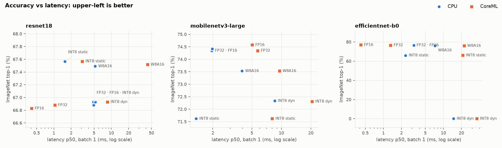
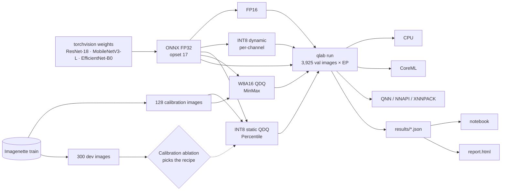
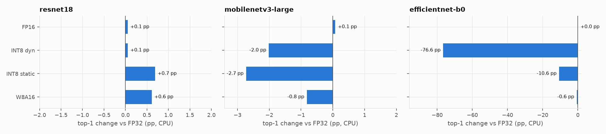
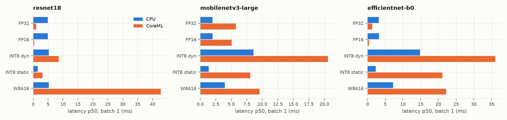

# quant-lab

[](https://github.com/RobiiAragon/quant-lab/actions/workflows/ci.yml)


**English** · [Español](README.es.md)

**What does quantization actually cost and buy you, on which hardware?** quant-lab takes three
ImageNet vision models and produces **five precisions** of each (FP32, FP16, INT8 dynamic,
INT8 static QDQ, W8A16 QDQ). It measures accuracy, agreement with FP32, latency, size and
accelerator coverage on CPU, Apple CoreML, and Qualcomm QNN or NNAPI when present, and
publishes the result as an executed notebook plus a self-contained HTML report.



- **Models:** ResNet-18, MobileNetV3-Large and EfficientNet-B0 (torchvision ImageNet weights,
  BSD-3), exported to ONNX opset 17.
- **Variants:** FP32 · FP16 (`onnxconverter-common`, float32 I/O) · INT8 dynamic (per-channel,
  ConvInteger) · INT8 static (QDQ, uint8 activations with Percentile calibration, per-channel
  int8 weights) · **W8A16** (QDQ, uint16 activations, the Qualcomm HTP recipe).
- **Evaluation:** all 3,925 Imagenette validation images, strict **1000-way ImageNet top-1**
  plus 10-way accuracy and top-1 agreement with FP32; batch-1 latency p50/p90/p99; EP coverage
  (nodes/partitions on the accelerator, parsed from ONNX Runtime's logs).
- **Recipe chosen on dev data:** a calibration ablation on *training* images, never the
  evaluation set ([`scripts/calibration_ablation.py`](scripts/calibration_ablation.py)).
- **Outputs:** [`notebooks/quant_lab.ipynb`](notebooks/quant_lab.ipynb) (executed, with Pareto
  frontier), [`docs/report.html`](https://robiiaragon.github.io/quant-lab/report.html)
  (self-contained), and PNG figures.

> **Why not YOLO/Ultralytics?** Ultralytics is AGPL-3.0, which doesn't fit an MIT repository.
> The torchvision models are BSD-3 and cover the same lesson: depthwise convolutions, SE
> blocks and SiLU/hard-swish are exactly where quantization hurts.

## Pipeline



## Quickstart

```bash
git clone https://github.com/RobiiAragon/quant-lab && cd quant-lab
python3.12 -m venv .venv && source .venv/bin/activate
pip install -e ".[dev]"

qlab download-models                        # 15 ONNX files from the GitHub release (~250 MB)
qlab run --limit 500 --out results/mine.json  # downloads Imagenette (99 MB) once
qlab report results/mine.json --out-dir out   # figures + out/report.html
```

Rebuild every variant locally (`pip install -e ".[train]"`): `qlab build` takes about 30 s
on an M5 Max. The full benchmark (`qlab run`, 30 configurations × 3,925 images) takes about
25 minutes.

## Results: measured on my Mac

**Hardware:** MacBook Pro (Mac17,6), Apple **M5 Max**, 48 GB RAM, macOS 27.2.
**Software:** Python 3.12.16, onnxruntime 1.32.0 (CPU EP; CoreML EP with `MLProgram`,
`MLComputeUnits=ALL`, static batch 1). **Data:** all 3,925 Imagenette validation images,
resize-256 / center-crop-224. Raw data: [`results/mac-m5max.json`](results/mac-m5max.json).

| Model | Variant | Top-1 (1000-way) | Agree w/ FP32 | CPU p50 | CoreML p50 | Size |
|---|---|---:|---:|---:|---:|---:|
| ResNet-18 | FP32 | 66.88% | 100% | 4.92 ms | 1.04 ms | 44.6 MB |
| | FP16 | 66.93% | 99.82% | 4.88 ms | **0.41 ms** | 22.3 MB |
| | INT8 dynamic | 66.93% | 93.50% | 5.25 ms | 8.55 ms | 11.2 MB |
| | INT8 static | 67.57% | 96.36% | **1.55 ms** | 3.12 ms | 11.3 MB |
| | W8A16 | 67.49% | 97.40% | 5.24 ms | 42.74 ms | 11.3 MB |
| MobileNetV3-L | FP32 | 74.34% | 100% | 1.95 ms | 5.74 ms | 20.9 MB |
| | FP16 | 74.42% | 99.87% | 1.97 ms | 5.03 ms | 10.5 MB |
| | INT8 dynamic | 72.33% | 85.15% | 8.56 ms | 20.59 ms | 5.5 MB |
| | INT8 static | 71.62% | 88.15% | **1.35 ms** | 8.07 ms | 5.7 MB |
| | W8A16 | 73.53% | 93.83% | 3.97 ms | 9.56 ms | 5.7 MB |
| EfficientNet-B0 | FP32 | 76.56% | 100% | 3.17 ms | 1.31 ms | 20.2 MB |
| | FP16 | 76.59% | 99.59% | 3.23 ms | **0.42 ms** | 10.1 MB |
| | INT8 dynamic | **0.00%** | 0.05% | 14.80 ms | 36.01 ms | 5.4 MB |
| | INT8 static | 65.96% | 77.73% | 2.34 ms | 21.11 ms | 5.9 MB |
| | W8A16 | 75.97% | 95.34% | 7.24 ms | 22.17 ms | 5.9 MB |

Top-1 and agreement are from the CPU runs (CoreML differs by ≤ 0.3 pp; FP16 on CoreML agrees
99.5% / 99.3% / 96.6% with FP32). 1000-way top-1 is strict: on Imagenette, 23–33% of FP32
predictions land on a *neighboring* ImageNet class (another dog breed, another fish). Restricted
to the 10 Imagenette classes, every FP32 model scores 97.7–99.4%.




### What I learned

1. **On Apple silicon, FP16 + CoreML wins whenever CoreML can take the whole graph:**
   **7.5–12× faster** than FP32 on CPU (ResNet-18 0.41 ms vs 4.92; EfficientNet 0.42 vs 3.17), half the size, and ≤ 0.3 pp
   accuracy change. CoreML takes 48–50 of ~50 ResNet nodes and 238–240 of ~240 EfficientNet
   nodes in 2 partitions.
2. **INT8 belongs on CPU (and on the Qualcomm NPU), not on CoreML.** Static INT8 is the fastest
   CPU option (ResNet-18 **3.2×** faster than FP32, MobileNetV3 1.4×). On CoreML the same
   models get *slower*: CoreML takes only 10/148 nodes of the QDQ ResNet (156/957 for
   EfficientNet), so every Q/DQ pair becomes a CPU↔accelerator hand-off. W8A16 on CoreML is
   the worst case (42.7 ms for ResNet-18).
3. **Architecture decides whether INT8 is safe.** ResNet-18 loses nothing (+0.7 pp). MobileNetV3 loses 2.7 pp. **EfficientNet-B0 collapses with dynamic INT8 (0% top-1)**
   and loses 10.6 pp with static INT8: depthwise convolutions, squeeze-excitation and SiLU have
   activation ranges that 8 bits can't hold. **W8A16 recovers it** (−0.6 pp), which is why
   Qualcomm's HTP recipe uses 16-bit activations.
4. **Calibration matters as much as bit-width.** On the dev split, MinMax calibration gave
   EfficientNet 33.7% top-1 and Percentile gave **65.0%** (FP32 79.7%), while per-tensor weights
   gave 0.7%. Entropy matched MinMax. Percentile won or tied for all three models, so it's the
   `int8-static` default. The ablation never touched the evaluation images.
5. **INT8 errors are fine-grained.** EfficientNet static INT8 drops 10.6 pp in 1000-way top-1
   but only 1.1 pp in 10-way accuracy (99.4% → 98.3%). Quantization blurs dog breed vs. dog
   breed far more than dog vs. church. Report both before calling a model "quantization-safe".
6. **MobileNetV3 and CoreML don't mix:** only 42/66 nodes in 21 partitions (hard-swish /
   hard-sigmoid), so CoreML is 2.9× slower than CPU, the same effect seen in
   [edge-ai-bench](https://github.com/RobiiAragon/edge-ai-bench).

**Pareto frontier on this Mac** (no other configuration is both faster and more accurate;
computed in the notebook):
- **ResNet-18:** FP16 on CoreML (0.41 ms) → FP32 on CoreML (1.04 ms) → INT8 static on CPU
  (1.55 ms, the most accurate at 67.57%).
- **MobileNetV3-L:** CPU dominates. INT8 static (1.35 ms) → FP32 / FP16 on CPU (~1.96 ms). FP16
  on CoreML only shows up for +0.15 pp at 2.5× the latency.
- **EfficientNet-B0:** FP16 on CoreML (0.42 ms, 76.87%) beats every other configuration.

### INT8 recipe ablation (dev set: 300 training images, not used for calibration)

| Recipe | ResNet-18 | MobileNetV3-L | EfficientNet-B0 |
|---|---:|---:|---:|
| FP32 reference | 69.7% | 77.0% | 79.7% |
| static MinMax, per-channel | 69.3% | 72.0% | 33.7% |
| **static Percentile, per-channel** | **70.0%** | **75.0%** | **65.0%** |
| static Entropy, per-channel | 69.3% | 72.0% | 33.7% |
| static MinMax, per-tensor | 70.0% | 74.0% | 0.7% |
| dynamic per-tensor | 69.3% | 76.0% | 0.0% |
| dynamic per-channel | 69.7% | 75.0% | 0.0% |

300 images means ±1 pp ≈ 3 images: differences below ~2 pp are noise. Data:
[`results/calibration_ablation_dev.json`](results/calibration_ablation_dev.json).

## Run it on the Galaxy Tab S9 Ultra (Termux)

```bash
pkg install -y git
git clone https://github.com/RobiiAragon/quant-lab && cd quant-lab
bash scripts/android_termux_check.sh                           # MobileNetV3, 500 images
MODELS=all LIMIT=1000 bash scripts/android_termux_check.sh       # everything
```

It installs Termux's prebuilt NumPy, ONNX Runtime and Pillow, downloads the models from the
release and Imagenette (99 MB), and benchmarks all five variants on **CPU, XNNPACK and NNAPI**
into `results/android-<model>.json`. On the Mac, `qlab report results/mac-m5max.json
results/android-*.json` adds the device to the report. NNAPI is where INT8 static should finally
win, because Snapdragon's NPU runs integer QDQ natively.

## Development

```bash
pip install -e ".[dev]"
ruff check . && ruff format --check . && pytest -q   # builds and runs all 5 variants on a tiny model
scripts/mac_check.sh                                  # QUICK=1 for 300 images; BUILD=1 to re-export
```

CI (ubuntu + macOS, Python 3.11/3.12) runs lint and the tests, regenerates the report from the
committed results, and uploads it as an artifact.

## Roadmap

- [ ] Tablet results (Snapdragon 8 Gen 2: CPU / XNNPACK / NNAPI) in this README
- [ ] QNN HTP on a Snapdragon X Elite laptop or Qualcomm AI Hub (W8A16 vs INT8 on the NPU)
- [ ] Quantization-aware training (QAT) for EfficientNet to close the static INT8 gap
- [ ] Mixed precision: keep SE blocks / first and last layers in FP16 and quantize the rest
- [ ] Object detection (SSDlite / RT-DETR, Apache-2.0) with COCO mAP
- [ ] Energy per inference (powermetrics on macOS)

## License

MIT © Jesús Aragón. Model weights: torchvision (BSD-3-Clause). Data: Imagenette by fast.ai
(repository under Apache-2.0); the images are a subset of ImageNet, so check ImageNet's terms
for anything beyond research and education. Neither weights nor images are redistributed in
git: models go in the GitHub release and Imagenette is downloaded on demand.
